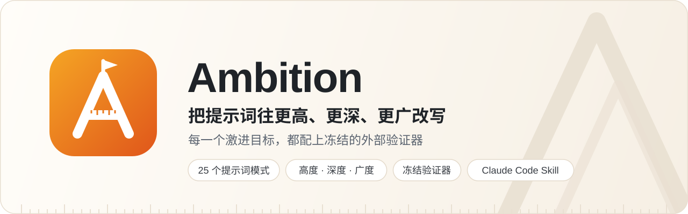
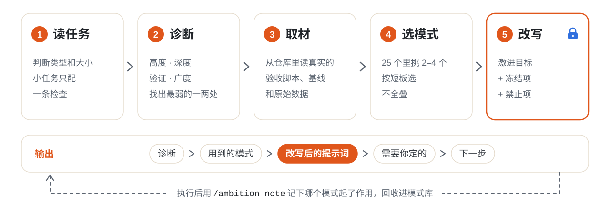
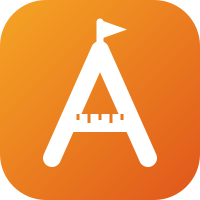

<p align="center">
  <picture>
    <source media="(prefers-color-scheme: dark)" srcset="assets/banner-dark.svg">
    
  </picture>
</p>

<p align="center">
  <a href="https://github.com/StatXzy7/ambition-skill/actions/workflows/validate.yml"></a>
  <a href="https://github.com/StatXzy7/ambition-skill/releases"></a>
  <a href="skills/ambition/references/patterns.md"></a>
  <a href="https://code.claude.com/docs/en/skills"></a>
  <a href="LICENSE"></a>
</p>

<p align="center"><a href="README.md">简体中文</a> · <b>English</b></p>

<p align="center">
  <a href="#quick-start">Quick start</a> ·
  <a href="#usage">Usage</a> ·
  <a href="#how-it-works">How it works</a> ·
  <a href="#example">Example</a> ·
  <a href="#pattern-library">Patterns</a> ·
  <a href="#faq">FAQ</a>
</p>

<br>

People usually ask models for too little. The task is written as a noun ("make a deck"), the model gets a digested summary instead of the raw material, and then it grades its own work.

**Ambition** is a Claude Code skill. Give it the prompt you were about to send, and it pushes the task higher, deeper, and wider. Wherever it raises the bar, it also freezes the validator and writes down what is forbidden.

| | Typical prompt | Where Ambition pushes it |
| --- | --- | --- |
| **Altitude** | "Make a deck", "fix this function" | Ask for the goal behind the goal: what should happen once this is done? |
| **Depth** | A summary and a cautious target | Raw material, the tools experts actually use, and an aggressive target |
| **Breadth** | Only methods from your own field | Methods from fields that have long worked on the same verb |
| **Verification** | The model says "done" | A frozen validator, threshold, and timing basis, plus explicit forbidden moves |

> [!IMPORTANT]
> When a model is pushed hard, the cheapest way to "succeed" is to quietly change the ruler: loosen a threshold, switch the timing baseline, keep only the favourable samples. So wherever Ambition raises the target, it locks the ruler. Outward it does the opposite: numbers in partner-facing material are always quoted like-for-like and with their qualifiers.

The skill's instructions and templates are written in Chinese. It writes the rewritten prompt in whatever language you use.

## Quick start

**Claude Code plugin (recommended)**

```text
/plugin install ambition --marketplace StatXzy7/ambition-skill
```

On Claude Code versions before 2.1.275, install in two steps:

```text
/plugin marketplace add StatXzy7/ambition-skill
/plugin install ambition@ambition-skill
```

<details>
<summary><b>Other ways to install</b></summary>

<br>

**npx skills**: install with the [vercel-labs/skills](https://github.com/vercel-labs/skills) CLI, into Claude Code or another tool that supports Agent Skills.

```bash
npx skills add StatXzy7/ambition-skill
```

**Manual copy**: best if you plan to grow your own pattern library with `add` and `note`.

```bash
git clone https://github.com/StatXzy7/ambition-skill.git
mkdir -p ~/.claude/skills
cp -r ambition-skill/skills/ambition ~/.claude/skills/
```

If you already have a skill named `ambition`, inspect it before replacing it.

</details>

Once installed, just ask "rewrite this prompt". To make rewrites cite the real scripts and paths in your projects, spend a few minutes filling in a [`contexts.md`](#teach-it-your-projects).

## Usage

| Command | What it does |
| --- | --- |
| `/ambition <prompt>` | Diagnose and rewrite this prompt |
| `/ambition` | With no argument, rewrite the task you just described in the conversation |
| `/ambition list [keyword]` | Show the pattern menu, e.g. `list 验证` (verification) |
| `/ambition add <text>` | Distil a prompt, an article excerpt, or something that worked into a new pattern |
| `/ambition note <ID> <result>` | Log how a pattern worked in practice, e.g. `note D2 2026-10-25｜perf｜good｜…` |

When installed as a plugin the command is namespaced as `/ambition:ambition`; plain `/ambition` also works unless another command already uses that name. You can skip the command entirely: "how should I phrase this prompt?" or "help me think bigger about this task" trigger it too.

Every rewrite has the same five parts:

1. **Diagnosis**: two or three sentences on what the original prompt lacks most.
2. **Patterns used**: one line each, with the reason.
3. **Rewritten prompt**: one copy-ready code block.
4. **Your decisions**: at most three things only you can decide, such as a target number or who signs off.
5. **Next step**: an offer to run the rewritten prompt.

## How it works

<p align="center">
  <picture>
    <source media="(prefers-color-scheme: dark)" srcset="assets/workflow-dark.svg">
    
  </picture>
</p>

- **Read the task**: classify its type and size. Small tasks, such as a rename or a localized bug fix, get a single "behaviour unchanged before and after" check and at most 15 lines.
- **Diagnose**: of altitude, depth, verification, and breadth, find the one or two weakest. Not every dimension needs fixing.
- **Gather material**: spend a few minutes in the working directory looking for real things: acceptance scripts, frozen baselines, raw data, earlier reports. Paths and numbers are read from files; anything it cannot find becomes a `{需要你填：…}` ("fill in") placeholder instead of a guess.
- **Pick patterns**: choose 2–4 that target the weak spots. Stacking all of them makes the prompt long and diffuse, and the one requirement that matters gets buried.
- **Rewrite**: aggressive targets are for internal work only, and the same prompt must state what is frozen and what is forbidden.

## Example

> Next week we meet a partner. Make a deck on our progress; we want them to keep working with us.

Rewritten (abridged, using R1, H3, V3):

```text
Task: in a {30-minute} meeting, get {the partner's technical lead} to believe
{our implementation works on the cases they care about}, agree to {provide the
next batch of measured data}, and leave with {a delivery date and acceptance test}.
First answer: what must they believe before they will do that? What is the most
convincing evidence for each, preferably something they can reproduce?
End with decisions: the three decisions this meeting should drive, each with the
options, pros and cons for both sides, the one we want, and why it is also best for them.
Evidence audit: every number traces to a file, commit, or script, with its validation
scope and comparison basis; mark anything without a source.
Only then choose the deck's format and length. Shorter is better.
{Fill in: who the partner is and what they must deliver this year.}
```

| This line of the rewrite | Comes from |
| --- | --- |
| In 30 minutes, get whom to believe and agree to what | `R1` Replace the noun with a verb |
| What must they believe first, before choosing a format | `R1` Replace the noun with a verb |
| End with decisions, each with pros and cons for both sides | `H3` End the meeting with decisions |
| Every number traces to a source, with its basis | `V3` Evidence audit |
| `{Fill in: …}` | Rewrite rule: uncertain facts are left for you, never invented |

## Pattern library

25 patterns in seven groups. Each states when to use it, when not to, a template, and its most common failure. The full text (in Chinese) is in [`patterns.md`](skills/ambition/references/patterns.md).

| Group | Patterns | Example |
| --- | --- | --- |
| **H** Altitude | H1–H5 | `H3` End with decisions: the three most urgent decisions, each with pros and cons for both sides |
| **D** Depth | D1–D6 | `D2` Aggressive target, frozen verifier: aim for 10x and lock the ruler and the timing basis |
| **V** Verification | V1–V3 | `V1` The verifier must first prove it can fail: plant known bugs; it counts only if it catches all of them |
| **R** Breadth | R1–R4 | `R1` Nouns into verbs: "make a deck" becomes "in 30 minutes, get whom to believe and decide what" |
| **P** Partners | P1–P2 | `P1` Reconstruct their situation from public primary sources: goals, blockers, worries |
| **S** Topic selection | S1 | `S1` Five questions: verification tier, frontier, unfair advantage, stop condition, extreme version |
| **F** Follow-ups | F1–F4 | `F2` Self-limitation check: have the last few rounds stayed in the safe zone? |

Typical starting points by task type:

| Task | Starting patterns |
| --- | --- |
| Engineering and optimization | `H2` · `D2` · `V1` · `D4` |
| Topic selection and research | `S1` · `H5` · `D6` · `R4` |
| Partner communication | `R1` · `H3` · `P1` · `V3` |
| Analysis and decisions | `H1` · `D4` · `D5` · `V2` |

<details>
<summary><b>All 25 patterns</b></summary>

<br>

| ID | Name | In one line |
| --- | --- | --- |
| H1 | The goal behind the goal | Keep asking "and then?" until you reach the outcome you actually want |
| H2 | From fixing one to keeping a property | Make a property always hold, maintained by the model, instead of fixing one instance |
| H3 | End meetings with decisions | The three most urgent decisions, each with arguments for and against |
| H4 | Replace the mechanism | Design a better process, backtest it on history, then run it in parallel |
| H5 | Work back from extreme success | Write the best output six months out, then derive week one |
| D1 | Deepening meta-prompt | Answer five questions first, then rewrite my prompt |
| D2 | Aggressive target, frozen verifier | Aim for 10x, and lock the ruler and the timing basis |
| D3 | Break "impossible" into assumptions | Split it into true limits and habits, and test each habit |
| D4 | Overturn conclusions from raw data | Reproduce or refute; matching a reference is not the same as correct |
| D5 | Look for what is new | Ask what just became possible; validate new signals on unseen data |
| D6 | Expert tools, not expert vocabulary | Name the library, solver, or statistical model first, then use it |
| V1 | The verifier proves it can fail | Plant known bugs; it counts only if it catches all of them |
| V2 | Independent review | An agent that did not build it hunts for claims that do not hold |
| V3 | Evidence audit | Every number and claim gets a source, qualifiers, and a verdict |
| R1 | Nouns into verbs | "Make a deck" becomes "in 30 minutes, get whom to believe and decide what" |
| R2 | Borrow another field's method | Find fields that have long solved the same verb; borrow methods, not roles |
| R3 | Due-diligence review | List what their experts will check and what they can reproduce on the spot |
| R4 | Parallel perspectives | Sub-agents each bring one discipline's method, with a search budget |
| P1 | Reconstruct their situation | Goals, blockers, and worries of the partner, from public primary sources |
| P2 | Turn meetings into commitments | Commitments, dates, acceptance tests, and the concerns left unsaid |
| S1 | Five topic-selection questions | Verification tier, frontier, unfair advantage, stop condition, extreme version |
| F1 | Ask for a better one | Same verifier, same threshold, on a harder case |
| F2 | Self-limitation check | Have the last few rounds stayed in the safe zone? |
| F3 | Ten times the resources | What would change with 10x, and what is its smallest version today? |
| F4 | The next question | What is the natural next question, and can we get there first? |

</details>

## Teach it your projects

It works with no setup, but rewrites will then leave `{需要你填：…}` placeholders where your real scripts and paths would go. To have it cite real files, copy the bundled [template](skills/ambition/references/contexts.md) and register your validators, raw material, external-claim rules, and workspace caveats:

```bash
mkdir -p ~/.claude/ambition
curl -fsSL https://raw.githubusercontent.com/StatXzy7/ambition-skill/main/skills/ambition/references/contexts.md \
  -o ~/.claude/ambition/contexts.md
```

The skill uses the first `contexts.md` it finds, in this order:

1. `.claude/ambition/contexts.md` in the current project, for that project only;
2. `~/.claude/ambition/contexts.md`, for all your projects;
3. the blank template bundled with the skill.

The first two are your own files and survive skill updates. See [`examples/contexts.example.md`](examples/contexts.example.md) for a filled-in, fictional example.

## Repository layout

```text
skills/ambition/
├── SKILL.md                  Workflow, argument dispatch, list / add / note
├── references/patterns.md    Menu, skeleton, 25 patterns, anti-patterns, changelog
├── references/contexts.md    Blank template for validators, material, and rules
└── evals/                    Four test prompts and a fixture
examples/contexts.example.md  A filled-in, fictional contexts file
scripts/validate.py           Repository checks, with a planted-error self-test
.claude-plugin/               Claude Code plugin marketplace manifest
```

## FAQ

<details>
<summary><b>How is this different from asking the model to "improve my prompt"?</b></summary>

<br>

Two ways. Each pattern comes from practice and says when not to use it, so the model does not pile every trick on. And there is one hard rule: wherever the target goes up, the same prompt must name a frozen validator and the forbidden moves. Without that, an aggressive target usually buys a success that came from changing the ruler.

</details>

<details>
<summary><b>Will a small task turn into an essay?</b></summary>

<br>

No. A rename or a localized bug fix gets one pattern and at most 15 lines, with no sub-agents and no loops. One of the evals checks exactly this.

</details>

<details>
<summary><b>I don't have a validator yet. What then?</b></summary>

<br>

Start with `V1`: write the validator before the solution, plant a few known bugs in a correct implementation, and accept the validator only if it catches all of them. Do not set an aggressive target until you have a validator that has been shown to fail.

</details>

<details>
<summary><b>Will it invent my script paths or partner details?</b></summary>

<br>

The rewrite rules require paths and numbers to be read from the working directory or `contexts.md`, with their source. Anything it cannot find becomes a placeholder. Facts such as who the partner is and what they care about are always left for you.

</details>

<details>
<summary><b>Does it work in English?</b></summary>

<br>

Yes. The instructions and templates are in Chinese, but the rewritten prompt follows the language you write in.

</details>

<details>
<summary><b>If I install it as a plugin, do my <code>add</code> / <code>note</code> edits survive updates?</b></summary>

<br>

No. A plugin update replaces the skill directory, including `patterns.md`. If you plan to grow your own library, fork the repository and install it manually. Your `contexts.md` lives in `~/.claude/ambition/` and is not affected.

</details>

## Inspiration and limits

The patterns adapt ideas from Felix Rieseberg's [How to be more ambitious: A tutorial for humans with models](https://felixrieseberg.com/how-to-be-more-ambitious-a-tutorial-for-humans-with-models/), Matthew D. Schwartz's [Claude-shaped science](https://www.anthropic.com/research/claude-shaped-science), and the [BootLoops protocols](https://github.com/BootLoops-ai/skills), plus the author's own practice porting scientific software, optimizing solvers, and preparing partner meetings. The source articles are not distributed here; see [NOTICE](NOTICE).

Evidence that the skill helps is thin. On four test cases from the author's private projects, responses with the skill met 27 of 28 expectations versus 22 of 28 without it. That is one small run, graded against expectations the author wrote. The four evals in this repository are generic rewrites of those cases and have not been re-run in this form.

A better prompt does not make a result correct. A frozen validator does, and the skill can only ask you for one; it cannot build or check it for you.

## Contributing

New patterns, field reports, and bug reports are welcome. Propose a pattern through the [issue templates](https://github.com/StatXzy7/ambition-skill/issues/new/choose) with a real prompt it improved. Before opening a pull request, run `python3 scripts/validate.py`. See [CONTRIBUTING.md](CONTRIBUTING.md).

## License

Original instructions, templates, and documentation are licensed under [Apache-2.0](LICENSE). The license does not grant rights to the source articles; see [NOTICE](NOTICE) for attribution.

<br>

<p align="center">
  
  <br>
  <sub>If it helped you think bigger about a task, a star is appreciated.</sub>
</p>
